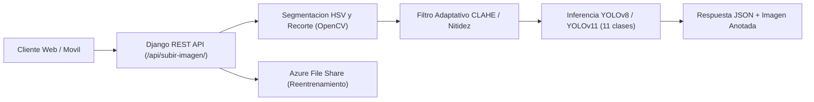

# Sistema de Detección de Billetes Falsos mediante Visión Artificial y Deep Learning (TT2)

API REST y pipeline de visión por computadora para autenticar billetes mexicanos (serie de $500 MXN) identificando sus elementos de seguridad mediante **OpenCV** y modelos de detección de objetos **YOLOv8 / YOLOv11 (`Ultralytics` + `PyTorch`)**, desplegado sobre **Microsoft Azure**.

---

## Arquitectura del Sistema

El proyecto se divide en tres módulos principales:
1. **Preprocesamiento de imagen (`OpenCV`):** Segmentación del billete, recorte automático de perspectiva/contorno y mejora adaptativa de contraste y nitidez antes de la inferencia.
2. ** Inferencia con Deep Learning (`YOLOv8` / `YOLOv11`):** Detección simultánea de 11 elementos de seguridad del billete y evaluación de umbrales de confianza.
3. **Reentrenamiento continuo (`reentrenamiento.py`):** Descarga automatizada de nuevas muestras desde **Azure File Share**, auto-etiquetado en formato YOLO y actualización de pesos (`best.pt`).



---

## Flujo Técnico de Procesamiento (`backend/api/views.py`)

### 1. Segmentación y Recorte (`recortar_billete`)
- Conversión de la imagen de entrada al espacio de color **HSV**.
- Aplicación de máscara de color y operaciones morfológicas (`cv2.MORPH_CLOSE` y `cv2.MORPH_OPEN`) para aislar el cuerpo del billete frente al fondo.
- Cálculo del contorno principal (`cv2.findContours`) y extracción de la región de interés (ROI) con margen de seguridad para no perder bordes relevantes.

### 2. Evaluación de Calidad y Mejora Adaptativa (`evaluar_calidad_imagen` y `mejorar_imagen`)
- **Cálculo de contraste:** Desviación estándar del histograma en escala de grises.
- **Cálculo de nitidez:** Varianza del operador Laplaciano (`cv2.Laplacian(gris, cv2.CV_64F).var()`).
- **Corrección condicional:**
  - Si el contraste es menor al umbral (`< 82`), convierte la imagen al espacio **LAB** y aplica ecualización adaptativa de histograma **CLAHE** (`clipLimit=1.8`, `tileGridSize=(8,8)`).
  - Si la nitidez es baja (`< 100`), aplica un filtro de convolución (`cv2.filter2D`) con kernel de enfoque `3x3`.

### 3. Detección de Elementos de Seguridad (`analizar_billete`)
El modelo entrenado (`best.pt`) evalúa la presencia, posición y porcentaje de confianza de **11 clases definidas en `data.yaml`**:

| ID | Clase | Elemento verificado en el billete ($500 MXN) |
| :--- | :--- | :--- |
| `0` | `banco` | Leyenda "Banco de México" |
| `1` | `hilo` | Hilo dinámico / banda de seguridad |
| `2` | `serie` | Folio / número de serie principal |
| `3` | `serie2` | Segundo número de serie |
| `4` | `numero` | Denominación numérica (500) |
| `5` | `texto` | Leyenda "Quinientos Pesos" |
| `6` | `benito` | Efigie principal (Benito Juárez) |
| `7` | `patron` | Patrón geométrico de seguridad |
| `8` | `marca` | Marca de agua |
| `9` | `carruaje` | Viñeta histórica / elemento gráfico secundario |
| `10` | `billete` | Cuerpo íntegro del billete |

---

## Pipeline de Reentrenamiento Automatizado (`reentrenamiento.py`)

Para mejorar la precisión del modelo frente a distintas condiciones de iluminación y cámaras móviles, el script `reentrenamiento.py` implementa un ciclo de aprendizaje continuo:
1. Conecta con **Azure File Share** mediante el SDK `azure-storage-fileshare` usando credenciales en variables de entorno (`AZURE_STORAGE_ACCOUNT_NAME`, `AZURE_STORAGE_ACCOUNT_KEY`).
2. Descarga los lotes de imágenes capturados en el servidor de producción.
3. Ejecuta inferencia con los pesos actuales (`best.pt`) y genera automáticamente los archivos de etiquetas `.txt` con coordenadas normalizadas (`class_id x_center y_center width height`).
4. Lanza el proceso de entrenamiento incremental con `Ultralytics YOLO` (`epochs=50`, `imgsz=640`, `batch=8`) y respalda los artefactos generados.

---

## Estructura del Proyecto

```text
TT2/
├── backend/
│   ├── api/
│   │   ├── views.py          # Endpoint REST, preprocesamiento OpenCV e inferencia YOLO
│   │   ├── urls.py           # Rutas de la API (/api/subir-imagen/)
│   │   └── models.py
│   ├── backend/
│   │   ├── settings.py       # Configuración Django, CORS y almacenamiento
│   │   └── wsgi.py           # Punto de entrada WSGI para Gunicorn en Azure
│   └── manage.py
├── reentrenamiento.py        # Pipeline de descarga desde Azure y reentrenamiento YOLO
├── data.yaml                 # Definición de las 11 clases del dataset
├── startup.sh                # Script de arranque para Azure App Service (Linux)
└── requirements.txt          # Dependencias (Django, DRF, PyTorch, Ultralytics, OpenCV, Azure SDK)
```

---

## Ejecución Local

```bash
# 1. Clonar el repositorio y crear entorno virtual
git clone https://github.com/Chuc4x/TT2.git
cd TT2
python -m venv venv
source venv/bin/activate  # En Windows: venv\Scripts\activate

# 2. Instalar dependencias
pip install -r requirements.txt

# 3. Iniciar servidor de desarrollo Django
cd backend
python manage.py migrate
python manage.py runserver
```

### Ejemplo de petición al Endpoint

```bash
curl -X POST http://localhost:8000/api/subir-imagen/ \
  -F "imagen=@billete_500.jpg"
```
