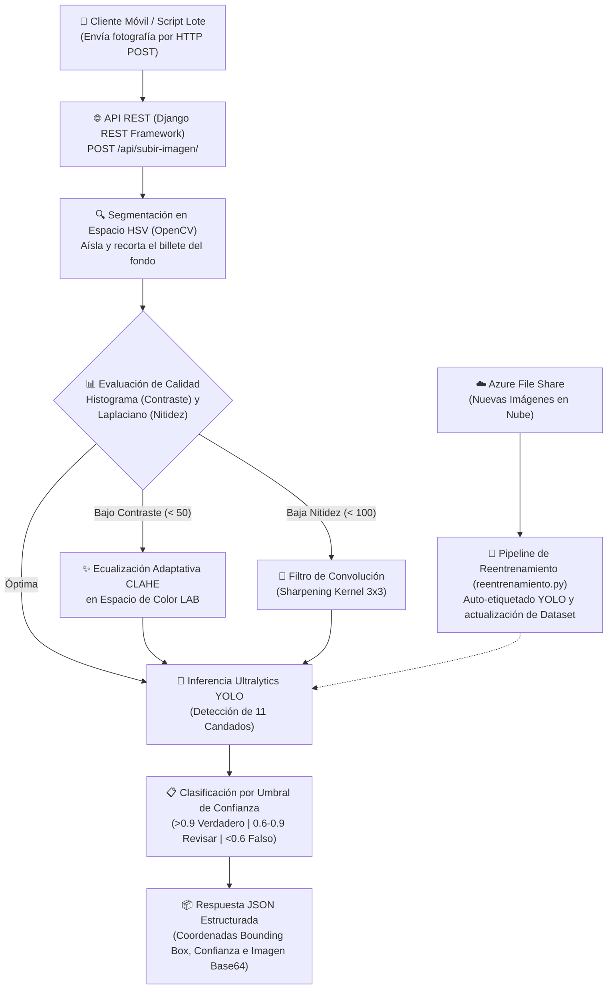

# 💵 Sistema de Autenticación de Billetes con Inteligencia Artificial y Visión por Computadora (ESCOM-IPN)

Backend de **Visión por Computadora, Deep Learning (`YOLOv8` / `YOLOv11`) y Pipeline de Reentrenamiento Automatizado (`Active Learning`)** desplegado en **Microsoft Azure** para la detección de billetes apócrifos mediante la inspección automática de **11 candados de seguridad física**.

---

## 🏗️ Arquitectura del Sistema y Flujo de Automatización



---

## 🔬 Etapas Técnicas del Pipeline

### 1. Segmentación Morfológica y Recorte Automático (`OpenCV`)
Antes de pasar la imagen a la red neuronal, el endpoint elimina el ruido del fondo:
* Conversión de `BGR` a espacio de color `HSV` (`cv2.cvtColor`).
* Aplicación de máscara por umbrales y operaciones morfológicas de cierre (`cv2.MORPH_CLOSE`) y apertura (`cv2.MORPH_OPEN`) con kernel `5x5`.
* Extracción del contorno externo de mayor área (`cv2.findContours`) y recorte automático de la región de interés (`ROI`).

### 2. Diagnóstico Matemático y Mejora Adaptativa de Imagen
Para mitigar malas condiciones de iluminación o desenfoque en cámaras móviles:
* **Detección de bajo contraste:** Calcula la desviación estándar del histograma en escala de grises (`hist.std() < 50`). Si requiere mejora, convierte la imagen al espacio `LAB` y aplica **CLAHE** (`clipLimit=3.0, tileGridSize=(8,8)`) sobre el canal de luminancia `L`.
* **Detección de desenfoque:** Calcula la varianza del operador **Laplaciano** (`cv2.Laplacian(gray, cv2.CV_64F).var() < 100`). Si detecta baja nitidez, aplica un filtro espacial de realce mediante `cv2.filter2D`.

### 3. Detección de 11 Candados de Seguridad (`YOLOv8` / `YOLOv11`)
El modelo entrenado evalúa simultáneamente **11 clases (`data.yaml`)** sobre el billete de $500 MXN:

| ID | Clase / Candado | Elemento Físico Inspeccionado |
|:---:|:---|:---|
| `0` | `banco` | Leyenda oficial *"Banco de México"* |
| `1` | `hilo` | Hilo dinámico 3D de seguridad |
| `2` | `serie` | Folio / Número de serie principal |
| `3` | `serie2` | Folio secundario de tamaño creciente |
| `4` | `numero` | Denominación numérica ($500) con cambio de color |
| `5` | `texto` | Textos y microtextos de seguridad |
| `6` | `benito` | Retrato / Efigie principal (Benito Juárez) |
| `7` | `patron` | Patrones geométricos y fondos lineales |
| `8` | `marca` | Zona de marca de agua |
| `9` | `carruaje` | Viñeta histórica de seguridad |
| `10` | `billete` | Encuadre e integridad general del billete |

---

## 📡 Ejemplo de Respuesta de la API REST (`POST /api/subir-imagen/`)

```json
{
  "mensaje": "Billete mejorado y guardado exitosamente.",
  "billete_id": 42,
  "imagen_base64": "/9j/4AAQSkZJRgABAQAAAQABAAD...",
  "detecciones": [
    {
      "candado": "hilo",
      "confianza": 0.964,
      "coordenadas": [142, 85, 210, 690],
      "clasificacion": "verdadero"
    },
    {
      "candado": "serie",
      "confianza": 0.941,
      "coordenadas": [820, 510, 1140, 585],
      "clasificacion": "verdadero"
    }
  ]
}
```

---

## 🔄 Automatización de Reentrenamiento con Azure File Share (`reentrenamiento.py`)
El repositorio incluye un pipeline automatizado de **Active Learning**:
1. Se conecta vía SDK (`azure-storage-fileshare`) al almacenamiento en la nube donde se depositan nuevas capturas.
2. Envía cada imagen al motor de inferencia y verifica si contiene el conjunto completo de candados requeridos.
3. Convierte automáticamente las coordenadas `xyxy` al formato normalizado de YOLO (`class x_center y_center width height`) y genera los archivos `.txt` de entrenamiento en `dataset/labels/train/`.

---

## 🛠️ Stack y Despliegue
* **Backend & API:** `Python 3.11+`, `Django 5.1`, `Django REST Framework`, `Gunicorn`
* **Visión Artificial & IA:** `Ultralytics YOLOv8 / YOLOv11`, `PyTorch`, `OpenCV (cv2)`, `NumPy`, `Pillow`
* **Cloud & CI/CD:** `Microsoft Azure App Service (Linux)`, `Azure File Share`, `GitHub Actions`
